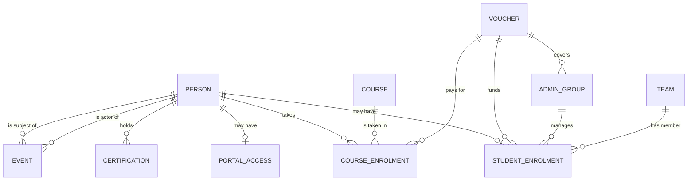

# User profile and activity log: phased implementation plan

**Project:** SANS Enterprise Portal prototype
**Written:** 16 October 2026
**For:** Matt (design), working with Claude Code or Codex in Cursor

This plan turns the placeholder profile page into the full user profile and adds a global activity log underneath it. It's written so you can hand one phase at a time to an AI coding agent. Each phase has its own scope, a "done when" checklist and a ready-to-paste prompt.

---

## How to use this plan

1. Do the phases **in order**. Each one builds on the last and leaves the prototype working.
2. For each phase, open Cursor's agent chat, paste the phase's **prompt** and let it work.
3. When the agent says it's finished, run the checks in **Done when** yourself in the browser (`npm run build`, then `python3 serve.py`).
4. Commit before starting the next phase (Phase 0 sets up git), so you can always roll back.
5. If something in a phase is a product decision rather than a build task, it's listed under **Open questions**. Agree it before that phase, or let the agent use the stated default.

---

## What you asked for

The profile page must show:

| Section | Contents | Editable? |
|---|---|---|
| Header | Name, work role, access roles (Admin, Limited Admin, Viewer, Student), status, email | Yes (modal) |
| Alerts and actions | Anything pending or needing attention for this person | Actions only |
| Admin access | Role, vouchers, admin groups, teams | Yes (modal) |
| Student details | Voucher, admin group, team | Yes (modal) |
| Training | Current course, completed courses with details, certifications | Yes (modal, scope TBC) |
| Activity log | Timestamped log of actions *done to* this person and *done by* this person, with a filter to show either or both. Shows the last 5 with an option to expand. | No (read-only by design) |

The activity log is the big one. Building it properly means changing how the prototype stores data, so most of the early phases are about the database.

---

## Key decisions (recommended)

These are the design choices the rest of the plan depends on. Each one is a recommendation. If you disagree, change it here before handing Phase 1 to the agent.

### 1. One person record, with roles attached

**Today:** someone who is both a portal user and a student exists as *two* user records, linked only by sharing an email address. That's fragile: change one email and the link breaks. Each record also has its own name, work role and status.

**Recommendation:** store each human once, as a **person**, and attach roles to them:

- a person can have **portal access** (Admin, Limited Admin, Viewer or SSO Admin, plus its scope)
- a person can have a **student enrolment** (voucher, admin group, team)
- a person can have either or both

The Portal Users and Students lists then become two filtered views of the same people. The profile page becomes one page per human, which is what you described ("Access Roles: Admin / Limited Admin / Viewer / Student").

### 2. Status lives on each role, not on the person

Someone can be an **active student** but have a **pending admin invitation**. So:

- each role has its own status: `Pending invite`, `Active` or `Suspended`
- the person separately has a **SANS account state**: `Linked` or `Awaiting account`
- the profile header shows a status chip per role, for example "Student · Active" and "Viewer · Pending invite"

### 3. The activity log is an append-only list of structured events

Every change anyone makes writes one **event**. Events are never edited or deleted. Each event records:

- **who** did it (the *actor*)
- **who** it was done to (the *subject*)
- **what** happened (an *action key*, such as `student.team_removed`)
- **what changed**, as before and after values
- **when**, as a timestamp

The sentence you read ("Priya Raman removed Ada Whitfield from Team: GRC & Audit") is built from the event when it's displayed, not stored as text. This means:

- the profile can filter "done to this person" (`subject`) and "done by this person" (`actor`)
- a future global activity page, exports and reporting can reuse the same data
- wording can be changed later without rewriting history

Events also keep a **snapshot of names**: the person's name and the team's name at the time. If someone is later renamed or deleted, the log still reads correctly.

### 4. All changes go through one "command" layer

Today, changes are made in many places across `app.js`, `fidelity.js` and `people.js`, each calling `commit()` and `record()` with a free-text message.

**Recommendation:** create one module, `src/store.js`, with a named function for every change, for example `inviteStudent()`, `changeStudentTeam()` and `updatePortalAccess()`. Each function:

1. checks the change is valid
2. applies it
3. writes the right event(s)
4. saves

The screens only call these functions. This is how you guarantee nothing is ever changed without being logged. It's also what a real back end will look like, which makes the hand-over to developers easier.

### 5. A "signed in as" switcher for testing

The log needs to know who did each action. The prototype currently has no signed-in user (the avatar just says "MS").

**Recommendation:** make the signed-in user one of the seeded portal users (default: **Ada Whitfield, Admin**), with a "Sign in as…" switcher in the profile menu. This lets you:

- see actions appear under the right person
- test "actions by this user" on someone else's profile
- later, test what Limited Admins and Viewers are allowed to see and edit

### 6. Alerts are worked out from the data, not stored

Most alerts follow from the data, so they're calculated whenever the profile is shown rather than saved as separate records. Examples: "Invitation pending for 6 days", "Awaiting SANS account", "Certification expires in 30 days". A small rules file, `src/alerts.js`, returns a list of `{ severity, title, detail, action }` for any person. The only stored items are things a person has asked for, such as a **training request awaiting approval**, which arrives in Phase 5.

---

## Target data model



### Database v3 shape

Written as TypeScript-style types for clarity. The prototype stays plain JavaScript.

```ts
type Database = {
  version: 3
  people: Person[]
  vouchers: Voucher[]          // was a hard-coded list in data.js
  adminGroups: AdminGroup[]    // was db.groups (strings)
  teams: Team[]                // was db.teams (strings)
  courses: Course[]            // new: mock SANS catalogue (Phase 5)
  courseEnrolments: CourseEnrolment[]   // new (Phase 5)
  certifications: Certification[]       // new (Phase 5)
  trainingRequests: TrainingRequest[]   // new (Phase 6)
  events: Event[]              // replaces db.activity
  session: { actorId: string } // who is "signed in" (prototype only)
}

type Person = {
  id: string
  name: string
  email: string               // unique across people
  workRole: string            // e.g. "SOC Analyst II"
  sansAccount: 'linked' | 'awaiting'
  createdAt: string           // ISO timestamp
  portal?: PortalAccess       // present = has portal access
  student?: StudentEnrolment  // present = is a student
  archivedAt?: string         // soft delete; never hard-delete people who appear in events
}

type RoleStatus = 'Pending invite' | 'Active' | 'Suspended'

type PortalAccess = {
  role: 'Admin' | 'Limited Admin' | 'Viewer' | 'SSO Admin'
  status: RoleStatus
  voucherIds: string[]        // Limited Admin: exactly 1
  adminGroupIds: string[]     // must be covered by the vouchers
  teamIds: string[]           // access, not membership
  invitedAt: string
  invitedBy: string           // person id
  lastAccessAt?: string
}

type StudentEnrolment = {
  status: RoleStatus
  voucherId: string           // required, exactly 1
  adminGroupId?: string       // optional, must be covered by the voucher
  teamId?: string             // optional, = membership
  invitedAt: string
  invitedBy: string
}

type Voucher    = { id: string; name: string; adminGroupIds: string[]; budget?: number; endsAt?: string }
type AdminGroup = { id: string; name: string }
type Team       = { id: string; name: string; createdAt: string; createdBy: string }

type Event = {
  id: string
  at: string                  // ISO timestamp
  actorId: string | 'system' | 'sans'   // who did it
  actorName: string           // snapshot
  subjectId?: string          // who it was done to (a person id)
  subjectName?: string        // snapshot
  action: ActionKey           // see the event catalogue below
  target?: { type: 'team' | 'adminGroup' | 'voucher' | 'course' | 'certification'; id: string; name: string }
  changes?: { field: string; from: unknown; to: unknown }[]
  batchId?: string            // groups events from one bulk action or CSV import
  via?: 'profile' | 'list' | 'bulk' | 'csv' | 'invite' | 'system'
}
```

### Migration from v2

The current saved data is `{ version: 2, users: [...] }` with separate portal and student records. The migration should:

1. **Group users by email** (lower-cased). Each email becomes one `Person`.
2. Take the name and work role from the student record if there is one, otherwise from the portal record.
3. Turn the portal record into `person.portal` and the student record into `person.student`.
4. Set `sansAccount` to `'awaiting'` if either record had `accountSetup: true`.
5. Convert team, admin-group and voucher names into ids.
6. Turn old `activity` messages into events with `action: 'legacy.note'` so nothing is lost.
7. Bump the storage key to `sans-enterprise-prototype-v3`, and keep a v2 importer so old snapshots can still be loaded.

---

## Event catalogue

Use these action keys. The **template** shows how each is displayed. `{actor}`, `{subject}` and `{target}` are filled in from the event, and the actor and subject names become links to their profiles.

| Action key | When | Template |
|---|---|---|
| `portal.invited` | Portal invite sent | {actor} invited {subject} as {role} |
| `portal.invite_resent` | Invite resent | {actor} resent {subject}'s portal invitation |
| `portal.invite_accepted` | Invite accepted (simulated by setting Active) | {subject} accepted their portal invitation |
| `portal.role_changed` | Role changed | {actor} changed {subject}'s role from {from} to {to} |
| `portal.voucher_added` / `portal.voucher_removed` | Voucher access changed | {actor} gave {subject} access to voucher {target} / removed … |
| `portal.admin_group_added` / `_removed` | Admin-group access changed | {actor} gave {subject} access to admin group {target} / removed … |
| `portal.team_access_added` / `_removed` | Team access changed | {actor} gave {subject} access to team {target} / removed … |
| `portal.suspended` / `portal.reactivated` | Status changed | {actor} suspended / reactivated {subject}'s portal access |
| `portal.revoked` | Portal access removed | {actor} removed {subject}'s portal access |
| `student.invited` | Student added | {actor} added {subject} as a student on {target} |
| `student.added_needs_voucher` | Imported without a voucher | {actor} added {subject} as a student, waiting for a voucher |
| `student.invite_released` | Voucher assigned to a Needs voucher student | {actor} sent {subject}'s student invitation after assigning a voucher |
| `bulk.undone` | Undo of a bulk action | {actor} undid {action} for {subject} |
| `student.invite_resent` | Invite resent | {actor} resent {subject}'s student invitation |
| `student.invite_accepted` | Accepted | {subject} accepted their student invitation |
| `student.voucher_changed` | Voucher changed | {actor} moved {subject} from voucher {from} to {to} |
| `student.admin_group_changed` | Admin group changed | {actor} moved {subject} to admin group {to} (or "removed … from admin group {from}") |
| `student.team_added` / `student.team_removed` / `student.team_changed` | Team membership | {actor} added {subject} to team {target} / removed {subject} from team {target} |
| `student.suspended` / `student.reactivated` / `student.removed` | Status | as above |
| `person.details_updated` | Name, email or work role changed | {actor} updated {subject}'s {field} from {from} to {to} |
| `person.account_created` | SANS account set up | {subject} created their SANS account |
| `person.archived` | Removed from organisation | {actor} removed {subject} from the organisation |
| `person.deleted` | Permanently deleted (erasure) | {actor} permanently deleted a person and their data |
| `training.requested` | Student requests a course | {subject} requested {target} |
| `training.approved` / `training.declined` | Admin decision | {actor} approved / declined {subject}'s request for {target} |
| `training.assigned` | Admin assigns a course | {actor} enrolled {subject} on {target} |
| `training.withdrawn` | Admin withdraws a student from a current course | {actor} withdrew {subject} from {target} |
| `training.completed` | Course completed (from SANS) | {subject} completed {target} |
| `certification.earned` / `certification.expiring` | From SANS | {subject} earned {target} / {target} expires on {date} |
| `team.created` / `team.renamed` | Team admin (subject is empty) | {actor} created team {target} |
| `import.completed` | CSV import summary (with batchId) | {actor} imported {n} students from {file} |
| `legacy.note` | Migrated v2 activity | (original message) |

**Rules for agents:**

- Every function in `store.js` that changes data must write at least one event. A test enforces this.
- Bulk actions write **one event per affected person**, all sharing a `batchId`, plus one summary event where useful (CSV import).
- A multi-field edit in a modal writes **one event per meaningful change**, not one vague "updated" event. For example, changing team and admin group together writes two events.
- Events are never updated or deleted. Deleting a person archives them instead.

---

## The profile page

### Layout (desktop)

```
← Back to Students

[AW]  Ada Whitfield                                   [Edit details]
      Security Program Lead · ada.whitfield@example.com
      [Admin · Active]  [Student · Active]   SANS account: Linked

┌ Needs attention ──────────────────────────────────────────────┐
│ ⚠ Training request awaiting approval: SEC504   [Review]       │
│ ⓘ GSEC certification expires in 28 days        [View]         │
└───────────────────────────────────────────────────────────────┘

┌ Admin access ──────────── [Edit] ┐  ┌ Student details ─ [Edit] ┐
│ Role       Admin                  │  │ Voucher      Leadership… │
│ Vouchers   4 · Cyber Defense FY26…│  │ Admin group  Federal Div │
│ Admin groups  All 3               │  │ Team         GRC & Audit │
│ Team access   All 4               │  └──────────────────────────┘
└──────────────────────────────────┘

┌ Training ─────────────────────────────────────────── [Manage] ┐
│ Current     SEC504 · Hacker Tools… · 45% · ends 12 Dec 2026   │
│ Completed   SEC401 (Mar 2025, 88%) · SEC275 (Nov 2024)   ▸    │
│ Certifications  GSEC · valid to 14 Nov 2026 · GCIH …     ▸    │
└───────────────────────────────────────────────────────────────┘

┌ Activity ──────────────── Show: [● Done to Ada] [● Done by Ada] ┐
│ Today                                                           │
│ 09:12  Priya Raman removed Ada from team GRC & Audit            │
│ 08:40  Ada invited Marcus Okonjo as Limited Admin               │
│ Yesterday                                                       │
│ 16:05  Ada approved Ken Adeyemi's request for SEC504            │
│ …                                                               │
│                      [Show more (23)]                           │
└─────────────────────────────────────────────────────────────────┘
```

### Behaviour

- **Header:** shows one chip per role with that role's status. "Edit details" opens a modal for name, email and work role.
- **Missing role:** if the person isn't a student, the Student details card says so and offers "Add as student". If they have no portal access, the Admin access card does the same with "Invite as portal user".
- **Editing a section:** each card's **Edit** opens a modal that reuses the existing forms (the voucher-first pickers already in `people.js`). On save it writes events and shows a toast such as "Team updated".
- **Removing a role:** done from inside that role's edit modal ("Remove portal access" or "Remove as student"), with a confirm step. It writes `portal.revoked` or `student.removed`.
- **Activity filters:** two toggles, **Done to {first name}** and **Done by {first name}**, both on by default. At least one must stay on. Events where the person is both actor and subject appear once.
- **Last 5 and expand:** show the 5 most recent matching events. "Show more" reveals 20 more at a time. Group by day (Today, Yesterday, 14 Oct 2026). Each entry shows the time, the sentence, and a "via CSV import" or "via bulk action" note where relevant.
- **Entry details:** clicking an entry expands its before/after values (`changes`) and batch information.
- **Permissions:** what the signed-in user can do depends on their role, and the profile follows the same rules.
  - Viewers see everything but no Edit buttons.
  - Limited Admins can edit student details only for people inside their voucher and admin groups, and can't edit admin access.

---

## Phases

### Phase 0: Make the code agent-friendly (half a day)

**Why:** the JavaScript files are minified onto very long single lines, which AI agents find hard to edit safely. There's no git history to roll back to, and no instructions file telling agents how this project works.

**Scope:**
- Run `git init` and make a first commit of the current prototype.
- Format `src/*.js` and `src/*.css` with Prettier. Formatting only: behaviour must be identical, and the tests must still pass.
- Add `AGENTS.md` (read by Codex and Cursor) and `CLAUDE.md` (read by Claude Code) covering:
  - what each `src` file does and the load order: data → app → fidelity → people → tables
  - the build and test commands
  - never edit `dist/` or `release/` by hand
  - copy uses modern UK English with sentence case headings
  - the people model rules (vouchers first, Limited Admin is one voucher, students have exactly one voucher, team access is not membership)
- Add `.gitignore` for `release/`, `*.zip` and `.DS_Store`.

**Done when:** the app looks and behaves exactly as before, `npm test` passes, and git shows a clean first commit.

<details><summary>Prompt for the agent</summary>

```
Read README.md and docs/profile-and-activity-plan.md (Phase 0 only).
1. Initialise git and commit the current state as "Baseline before profile work".
2. Add Prettier as a dev dependency and format src/*.js and src/*.css. This must be a pure formatting change: do not alter behaviour. Run `npm run check`, `npm test` and `npm run build` afterwards.
3. Create AGENTS.md and CLAUDE.md (same content) describing: the purpose of each file in src/, the load order in build.mjs, build/test commands, "never edit dist/ or release/", "all UI copy in modern UK English with sentence case headings", and the people-model rules listed in README.md under "People model".
4. Add a .gitignore for release/, *.zip, .DS_Store and node_modules/.
5. Commit as "Format source and add agent instructions".
Stop and summarise what changed. Do not start Phase 1.
```
</details>

---

### Phase 1: Database v3 and the store (1–2 days) — foundation

**Why:** everything else depends on one-person-many-roles and on a single place where changes happen.

**Scope:**
- New `src/store.js`:
  - load and save the database, and migrate v2 data to v3 (see "Migration from v2")
  - read helpers: `getPerson(id)`, `listPortalUsers(filters)`, `listStudents(filters)`, `peopleInTeam(id)`, `peopleWithTeamAccess(id)`
  - command functions for every change the app already supports:
    - invite portal user
    - add student
    - edit portal access
    - edit student details
    - change status
    - resend invite
    - archive person
    - create team
    - CSV import commit
    - bulk status
- Vouchers, admin groups and teams become records with ids. The voucher-to-admin-group mapping moves into `vouchers[].adminGroupIds`.
- Rewire the existing screens (Portal Users, Students, CSV import, invite flows, edit dialogs, team and admin-group pages, profile placeholder) to read through the store and change data only via command functions.
- Delete becomes **archive**: archived people disappear from the lists but stay in the database.
- Update the seed so Ada Whitfield and Tom Halloway are single people with both roles.
- Tests:
  - the migration from a v2 snapshot
  - one person per email
  - the role rules (Limited Admin has one voucher, students have exactly one voucher, admin groups are covered by the vouchers)
  - archive keeps the record

**Done when:** every existing flow in the README walkthrough still works, the lists look the same, an exported v2 snapshot imports correctly, and all tests pass.

<details><summary>Prompt for the agent</summary>

```
Read AGENTS.md and docs/profile-and-activity-plan.md, especially "Key decisions" 1, 2 and 4, "Target data model" and "Migration from v2". Implement Phase 1 only.
- Create src/store.js with the v3 schema, a v2→v3 migration, read helpers and one command function per data change the app already supports. Screens must not mutate db directly any more.
- Keep the existing UI and copy identical; this phase is a data refactor.
- Replace hard delete with archive (person.archivedAt).
- Update tests/data.test.mjs and add tests for migration, role rules and archive.
- Bump the storage key to sans-enterprise-prototype-v3.
Leave the existing record()/activity calls in place for now; Phase 2 replaces them. Run check, test and build. Then walk through the README's five-minute walkthrough in a browser and confirm it works. Summarise what changed and any decisions you had to make.
```
</details>

---

### Phase 2: Event log foundation (1 day)

**Why:** once the store exists, logging every change is one consistent job.

**Scope:**
- Add `events` to the database and a `logEvent(db, {...})` helper in `store.js` that fills in `id`, `at`, actor snapshot and subject snapshot.
- Every command function writes events using the **Event catalogue** keys, with `changes`, `target`, `batchId` and `via`.
- Add the "Sign in as…" switcher to the profile menu (default: Ada Whitfield). The current actor comes from `db.session.actorId`.
- New `src/activity.js` with:
  - `describeEvent(event)`, which returns the display sentence from the templates
  - `eventsFor(personId, { to, by })` for the profile filter
- **Seed history:** generate around 60 back-dated events over the last 90 days, so profiles and the Home feed aren't empty. Include invites, team moves, voucher changes, a CSV import batch, suspensions and acceptances.
- Point the Home page's "Recent activity" at the new events, using `describeEvent`.
- Remove the old `record()` and `activity` code.
- Tests:
  - every exported command function writes at least one event, by running each one against a fresh seed
  - bulk actions share a `batchId`
  - events survive archiving the subject

**Done when:** doing anything in the app adds a correctly worded entry to the Home activity feed, attributed to whoever you're signed in as.

<details><summary>Prompt for the agent</summary>

```
Read AGENTS.md and docs/profile-and-activity-plan.md ("Key decisions" 3 and 5, "Event catalogue"). Implement Phase 2 only.
- Add db.events and logEvent() to src/store.js; make every command function log events using the catalogue's action keys, with before/after `changes`, `target`, `batchId` for bulk/CSV actions and `via`.
- Add db.session.actorId and a "Sign in as…" list in the profile menu (portal users only). Default Ada Whitfield.
- Create src/activity.js with describeEvent() (templates from the catalogue, names rendered as profile links) and eventsFor(personId, {to, by}).
- Generate realistic back-dated seed events (~60 over 90 days).
- Switch Home "Recent activity" to events; remove record()/db.activity.
- Add a test that calls every exported command and asserts at least one event is written, plus batchId and archive tests.
Run check, test, build; verify in the browser. Summarise.
```
</details>

---

### Phase 3: Profile page, part 1 — header, admin access, student details (1–2 days)

**Scope:**
- Replace the placeholder in `tables.js` with a new `src/profile.js` that follows the **profile page** layout above. Leave out Training and the Alerts strip for now, with "Coming soon" placeholders.
- The header shows name, work role, email, role chips with per-role status, and SANS account state. "Edit details" opens a modal for name, email and work role.
- The **Admin access** card has an Edit modal that reuses the voucher-first scope pickers from `people.js`, with the same validation (Limited Admin has one voucher) and a "Remove portal access" option.
- The **Student details** card has an Edit modal with the voucher, admin group and team selects, plus a "Remove as student" option.
- Empty states offer "Invite as portal user" or "Add as student".
- Every save goes through store commands, so events are written automatically.
- Apply permissions according to the signed-in user's role. Viewers get no Edit buttons. Limited Admins can only edit students inside their scope, and the Admin access card is read-only for them.
- Shows correctly at phone width.

**Done when:** you can open any person, edit each section, and see the change on the card straight away and in the Home activity feed. Signing in as a Viewer hides the Edit buttons.

<details><summary>Prompt for the agent</summary>

```
Read AGENTS.md and docs/profile-and-activity-plan.md ("The profile page", Phase 3). Implement Phase 3 only.
Create src/profile.js (add it to build.mjs after tables.js) replacing the placeholder profileView in tables.js. Build the header, Admin access card and Student details card with edit modals that reuse the existing voucher-first pickers/validation from people.js, plus remove-role options with confirmation. All saves go through store.js commands. Respect permissions based on the signed-in role (Viewer: read-only; Limited Admin: only students within their voucher/admin groups, admin access read-only). Use placeholders for Training, Alerts and Activity. Match the existing visual style (fidelity.css tokens, Material Symbols via icon()). UK English, sentence case. Check at 1440px and 390px wide. Run check/test/build and summarise.
```
</details>

---

### Phase 4: Activity log on the profile (1 day)

**Scope:**
- An **Activity** card on the profile using `eventsFor(personId, { to, by })`:
  - two filter toggles, "Done to {first name}" and "Done by {first name}", both on by default, with at least one always on
  - entries grouped by day, each showing the time and the sentence from `describeEvent`; names link to profiles
  - the last 5 entries shown, with "Show more" revealing 20 at a time and a count of what's left
  - clicking an entry expands it to show before/after values and "Part of CSV import / bulk action (n people)"
  - an empty state: "No activity yet"
- The filter choice is remembered per browser session.

**Done when:** on Ada's profile you can switch between actions done to her, done by her, or both. Making a change on someone else's profile while signed in as Ada shows up under "Done by Ada".

<details><summary>Prompt for the agent</summary>

```
Read docs/profile-and-activity-plan.md ("The profile page → Behaviour", Phase 4). Implement Phase 4 only: the Activity card in src/profile.js using eventsFor() and describeEvent() from src/activity.js. Two toggles (done to / done by, at least one on), day grouping, last 5 with "Show more" (+20), expandable entries showing `changes` and batch info, empty state. Remember the filter in sessionStorage (wrapped in try/catch). Add tests for eventsFor filtering, including events where actor and subject are the same person (shown once). Run check/test/build and summarise.
```
</details>

---

### Phase 5: Training data and the Training section (1–2 days)

**Why:** training data will come from SANS's systems in production, so the prototype mocks it.

**Scope:**
- Add `courses`, `courseEnrolments` and `certifications` to the database, with a small mock catalogue:
  - SEC275, SEC401, SEC504, SEC560, FOR508, LDR512, ICS410 and similar
  - GIAC certifications (GSEC, GCIH, GPEN, GCFA and so on), each with issue and expiry dates
- Enrolment status is `requested`, `approved`, `in_progress`, `completed` or `withdrawn`. Each enrolment stores the voucher that paid for it, its start and end dates, progress percentage and final score.
- Seed realistic training histories for most students.
- **Training** card:
  - the current course(s) with progress and end date
  - a completed courses list, expandable for dates, score and voucher
  - certifications with a "valid / expiring soon / expired" chip
- **Manage training** modal (scope to confirm, see Open questions). Default for the prototype:
  - assign a course on the student's voucher
  - withdraw from a current course
  - Admins and Limited Admins only
- Writes `training.*` and `certification.*` events, and seeds some of them.

**Done when:** students show believable training histories, and assigning or withdrawing a course updates the card and the activity log.

<details><summary>Prompt for the agent</summary>

```
Read docs/profile-and-activity-plan.md (Phase 5 and the training rows of the Event catalogue). Implement Phase 5 only. Add courses, courseEnrolments and certifications to the v3 schema (with migration defaults), a mock SANS catalogue and seeded histories. Build the Training card in src/profile.js and a "Manage training" modal (assign course on the student's voucher; withdraw current course) for Admin/Limited Admin. All changes via store.js commands that log training.* events. Tests for the new commands and seed integrity. Run check/test/build and summarise.
```
</details>

---

### Phase 6: Alerts and pending actions (1 day)

**Scope:**
- Add `trainingRequests` to the database, as students' requests awaiting approval. Seed a few.
  - *Built as:* a request is a course enrolment with status `requested` (added in Phase 5), so there is no separate `trainingRequests` table. Approving sets `approved`; declining sets `withdrawn`.
- New `src/alerts.js` with `alertsFor(person, db, viewer)`, which returns sorted alerts. Starting rules:

| Rule | Severity | Action button |
|---|---|---|
| Training request awaiting approval (viewer can approve) | Action needed | Review → approve or decline modal |
| Portal or student invite pending more than 5 days | Warning | Resend invitation |
| Awaiting SANS account for more than 7 days | Warning | Resend invitation |
| Certification expires within 60 days | Warning | View |
| Certification expired | Error | View |
| Course end date passed but not completed | Warning | View |
| Role suspended | Info | Reactivate (if permitted) |
| Student has no team (optional, off by default) | Info | Assign team |

- A **Needs attention** strip on the profile header, hidden when there's nothing.
- A small count badge in the lists' Status column. Optional: a "Needs attention" filter.
- The approve and decline modal writes `training.approved` or `training.declined` events.

**Done when:** pending invites, expiring certifications and training requests show on the right profiles, and acting on them clears the alert and logs the action.

<details><summary>Prompt for the agent</summary>

```
Read docs/profile-and-activity-plan.md ("Key decisions" 6, Phase 6). Implement Phase 6 only: trainingRequests in the schema and seed, src/alerts.js with alertsFor() implementing the rules table, the "Needs attention" strip on the profile with action buttons, an approve/decline modal (logs training.approved/declined), and an alert count badge in the people lists. Only show actions the signed-in role is allowed to take. Unit-test each alert rule. Run check/test/build and summarise.
```
</details>

---

### Phase 7: Global activity log and polish (built)

*Built as described. Developer notes are in `docs/activity-log-developer-notes.md`. Open question 1's default is implemented for the Activity page and CSV export.*


- An **Activity** page in the sidebar, under Admin: the whole organisation's events, filterable by person, action type, date range, admin group and voucher, and exportable as CSV.
- Group CSV and bulk batches into one expandable entry.
- Show "Last modified by" in the lists from the latest event rather than mock text.
- Retention and immutability notes for developers; for example, events are written server-side in production and never by the browser.
- Accessibility pass on the profile: headings, landmarks, focus order in the modals, and the timeline announced as a list.

---

## Open questions (for SANS)

1. **Who can see activity?** Can a Limited Admin see actions done by Admins outside their scope? Default: they see events about people in their scope only.
2. **How far back?** Is there a retention period for activity (for example, 2 years)? Default: none in the prototype.
3. **Training edits:** what can an admin actually change about training in the portal? Assign courses, withdraw, change the funding voucher, or only approve requests? Default: assign and withdraw.
4. **Status per role:** confirm that someone can be an active student with a pending admin invite (decision 2).
5. **Archiving vs deleting:** is there a legal need to fully delete a person (GDPR erasure)? If so, the log needs an anonymisation rule, such as replacing the name with "Deleted user". Default: archive only.
6. **System actors:** which events come from SANS rather than a person (course completion, certification issued, account created)? Default: as marked in the catalogue.
7. **Alert thresholds:** confirm pending-invite days (5), certification-expiry warning (60 days), and whether "no team" should alert.

---

## Rough effort

| Phase | Effort with an agent | Risk |
|---|---|---|
| 0 Agent-friendly code | half a day | Low |
| 1 Database v3 and store | 1–2 days | **High.** It touches everything, so test carefully |
| 2 Event log | 1 day | Medium |
| 3 Profile part 1 | 1–2 days | Medium |
| 4 Activity on profile | 1 day | Low |
| 5 Training | 1–2 days | Low |
| 6 Alerts | 1 day | Low |
| 7 Global log and polish | later | Low |

**Tip:** if you want something to show SANS sooner, Phases 3 and 4 can be built against the *current* data with mocked events first. But you'd redo them after Phases 1 and 2, so the order above is the cheaper route overall.
